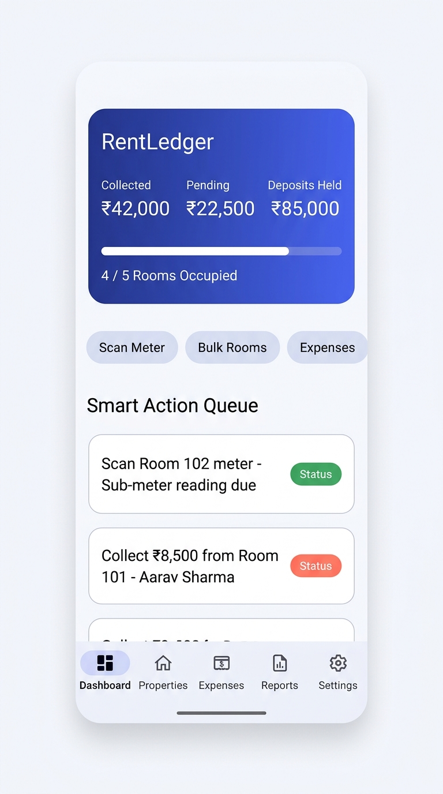
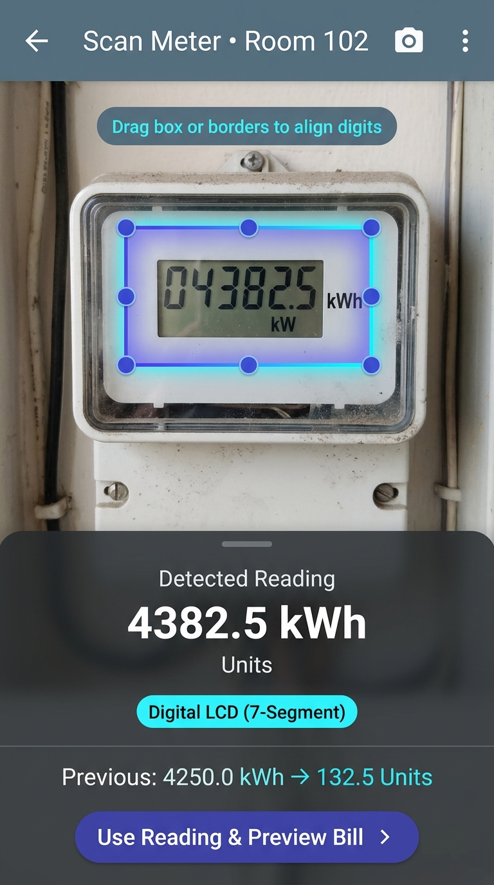
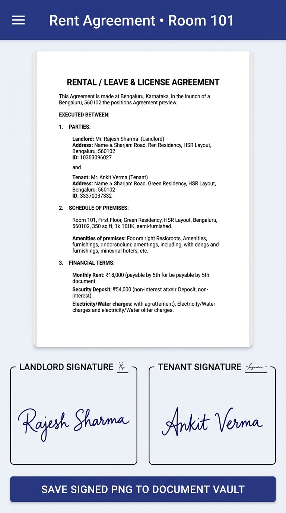
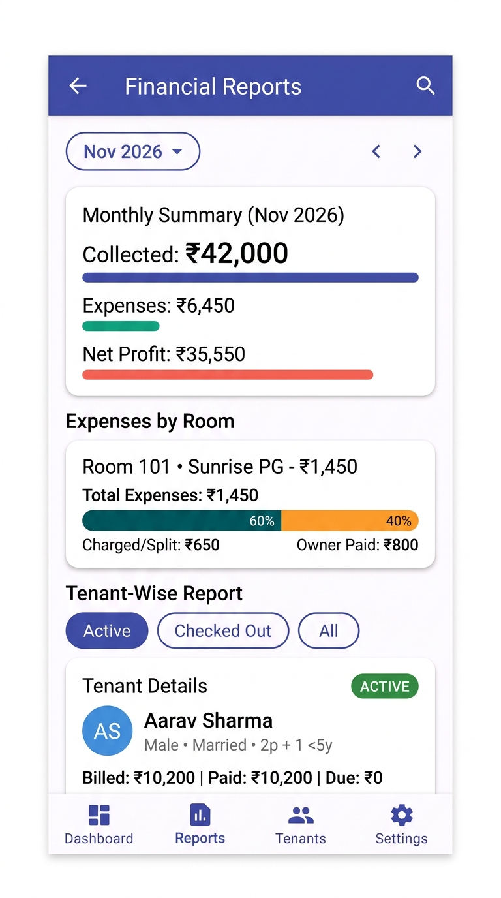

# RentLedger

**Offline-first Android Property, PG & Utility Billing Ledger with On-Device Electricity Meter OCR, Digital Rent Agreements, and Portable Backups**

RentLedger is a production-grade Kotlin & Jetpack Compose Android application built for landlords, hostel/PG operators, and small commercial property managers. It streamlines the entire tenancy lifecycle—from bulk room onboarding and KYC document storage to camera-based sub-meter reading via on-device OCR, itemized PDF invoicing, room-level expense splitting, and dual-signed rental agreements—all **100% offline** with zero server dependency.

---

## Demo Screenshots

| Dashboard & Smart Tasks | On-Device Meter OCR Scanner | Dual-Signed Rent Agreement | Reports, Room Expenses & Tenants |
| :---: | :---: | :---: | :---: |
|  |  |  |  |

---

## Product & Feature Highlights

### Property & Unit Management
- **3-Tier Hierarchical Defaults:** Common Owner Settings → Property Overrides → Room/Unit Overrides for electricity billing mode/rate, water billing mode/rate, and security deposits.
- **Bulk Room Creation:** Generate numbered rooms in batches (e.g., `Room 101–120` or zero-padded `Unit 001–010`) with live preview and duplicate-name guards, sharing rent, utility, and meter settings.

### On-Device Meter OCR & Flexible Electricity Billing
- **Dual-Engine Meter OCR:** Live **CameraX** viewfinder + **Gallery Photo Crop** paired with **ML Kit Text Recognition** and **Tesseract4Android** (`letsgodigital.traineddata` bundled in assets) for both **7-Segment Digital LCD** and **Analog Drum** meters.
- **Direct-Drag & Border-Resizable ROI Box:** Touch-drag anywhere inside the Region-of-Interest box to reposition it or drag any edge border directly to resize width and height for accurate digit alignment.
- **Flexible Electricity Modes:** Supports `Metered (Sub-meter)`, `Separate EB Meter` (tenant pays utility board directly, ₹0 on rent bill), and `Included in Rent` (₹0 extra)—automatically adapting dashboard tasks, billing previews, and checkout flows.

### Tenant Lifecycle, Media Vault & Digital Agreements
- **Check-In & Demographics:** Tracks Gender, Marital Status, optional profile photo, Persons aged 5+ (counted in per-person water/tanker splits), and Children `< 5 yrs` tracked separately without inflating per-person utility splits.
- **Recurring Check-In Charges:** Optional monthly Maintenance and custom Extra charges (e.g., Parking/Wi-Fi) saved on the lease, prefilled on bill previews, and included in dashboard expected totals.
- **App-Private Media Vault:** Stores ID proofs, work/police verification documents, meter snaps, profile photos, and agreements privately inside app storage (`filesDir/media/`) via live **Camera** or **Photo Picker / PDF upload**—keeping the device gallery uncluttered and enabling full backup portability.
- **Signed Rent Agreement Generator:** Interactive dual **Landlord** and **Tenant** drawing signature pads (`Canvas`) baked onto a formal government-aligned Rental / Leave & License PNG image stored directly in the tenant's document vault.

### Expenses, Invoicing, Reports & Automation
- **Room-Level & Shared Expenses:** Record expenses as `Owner Only` (tracking), `Charge Selected Room` (auto-attaches to that room's next bill), `Split Per Room`, or `Split Per Person`.
- **PDF Invoices & Check-Out Settlement:** Generates itemized monthly PDF bills and tenant statements using Android's native `PdfDocument` API with WhatsApp/share support and final deposit-minus-deduction checkout reconciliation.
- **Financial & Tenant-Wise Reports:** Monthly cashflow bar chart, property-wise net P&L, **Expenses by Room** progress breakdown, **Security Deposits Held**, and **Tenant-Wise Report** (`Active` / `Checked Out` / `All` filters).
- **Bill Prep Reminders, App Lock & `.zip` Backup:** Configurable **Rent Generation Day** (defaulting to the *Last Day of Month*, adapting to 28/29/30/31 days) using inexact `AlarmManager` notifications, `BiometricPrompt` app lock, and full `.zip` archive export/import bundling JSON state + private media files.

---

## Technical Architecture & Engineering Decisions

RentLedger follows **MVVM + Unidirectional Data Flow (UDF)** with a **Single-Activity Jetpack Compose** UI, reactive **Kotlin Coroutines & `Flow`**, and a strictly offline relational **Room** persistence layer.

### 1. UI & Adaptive Navigation
- **Jetpack Compose + Material 3 (`RentLedgerTheme`):** Custom `Theme.kt` supporting Light/Dark/System modes and 3 accent themes (*Royal Indigo*, *Emerald Mint*, *Terracotta*) with `CompositionLocalProvider` semantic status colors (`paid`, `partial`, `due`) and `enableEdgeToEdge()`.
- **Type-Safe Navigation:** Uses `androidx.navigation.compose` (`2.8.9`) with `@Serializable` sealed `Route` destinations (`Dashboard`, `Properties`, `Expenses`, `Reports`, `Settings`, `CheckIn`, `MeterScanner`, `BillPreview`, `InvoicePayment`, `CheckOut`, `TenantProfile`, `RentAgreement`).
- **Responsive Form Factors:** Uses `BoxWithConstraints` at the root scaffold to switch cleanly between a bottom `NavigationBar` on compact phones and a `NavigationRail` on wider/tablet screens.

### 2. Data Layer & Schema Evolution (`Room v5` + `DataStore`)
- **Relational Integrity:** `RentLedgerDatabase` (`version = 5`) manages 9 entities (`properties`, `units`, `leases`, `tenant_documents`, `meter_readings`, `invoices`, `payments`, `expenses`, `shared_charges`) with cascading foreign keys and query indices.
- **Safe Incremental Migrations:** Explicit SQL `Migration` objects (`MIGRATION_1_2` through `MIGRATION_4_5`) preserve existing user data across schema upgrades.
- **Atomic Financial Operations:** Billing (`createBillAndSaveReading`), tenant check-in/out (`checkInTenant`, `completeCheckOut`), bulk unit inserts (`saveUnitsBulk`), and expense splitting (`saveExpenseWithSplit`) execute inside `db.withTransaction { ... }` to guarantee consistent ledgers and prevent double-billing of `SharedChargeEntity` rows.
- **Reactive Aggregation:** `observeUnitsWithContext()` and `observeDashboardSummary()` compose multi-table Room flows with `SettingsDataStore` via `combine(...)` and expose `StateFlow` via `stateIn(..., SharingStarted.WhileSubscribed(5000))`.

### 3. On-Device Computer Vision & Document Engines
- **`MeterOcrEngine` & `MeterReadingParser`:** Normalizes EXIF rotation, crops to the user-adjusted `NormalizedRoi`, pre-processes contrast/grayscale, extracts candidates using ML Kit + Tesseract (`letsgodigital`), validates plausibility against the prior reading (flagging anomalies without silent corruption), and persists cropped meter evidence.
- **`RentAgreementGenerator` & `PdfInvoiceGenerator`:** Renders multi-section `StaticLayout` text and vector ink strokes (stored as normalized `0f..1f` coordinates for crisp high-DPI scaling) onto `Bitmap`/`Canvas` PNGs and native `PdfDocument` pages.
- **`BackupZipManager`:** Serializes the complete `BackupSnapshot` (v3) via `kotlinx.serialization` alongside `filesDir/media/*` into a single `.zip` archive via Android's Storage Access Framework (`CreateDocument` / `OpenDocument`), enforcing canonical-path prefix validation to guard against Zip Path Traversal on restore.

### 4. Privacy & Google Play Policy Compliance
- **Zero Broad Storage Permissions:** Uses Android Photo Picker (`PickVisualMedia`), Storage Access Framework (`OpenDocument`/`CreateDocument`), and `FileProvider` for camera capture (`CAMERA` only when scanning or photographing docs).
- **Notification & Alarm Hygiene:** Uses inexact `AlarmManager.setInexactRepeating` (avoiding `SCHEDULE_EXACT_ALARM`) and runtime `POST_NOTIFICATIONS` permission handling on Android 13+ (API 33+).

---

## Tech Stack

| Layer | Technology / Library | Version |
| :--- | :--- | :--- |
| **Language & Build** | Kotlin / Android Gradle Plugin / KSP | `2.2.10` / `9.1.1` / `2.3.5` |
| **SDK Targets** | `compileSdk 36` / `targetSdk 36` / `minSdk 24` | Java 11 bytecode |
| **UI Framework** | Jetpack Compose BOM + Material Design 3 | `2024.09.00` |
| **Navigation** | Navigation Compose (Type-Safe `@Serializable`) | `2.8.9` |
| **Local Database** | AndroidX Room (Runtime, KTX, KSP Compiler) | `2.7.0` |
| **Preferences** | Jetpack DataStore (Preferences) | `1.1.7` |
| **Async & Serialization** | Kotlinx Coroutines + Kotlinx Serialization JSON | `1.10.2` / `1.8.0` |
| **Camera & OCR** | CameraX (`1.5.0`), ML Kit Text Recognition (`16.0.1`), Tesseract4Android (`4.9.0`), ExifInterface (`1.3.7`) | — |
| **Image Loading & Security** | Coil Compose (`2.7.0`), AndroidX Biometric (`1.1.0`) | — |
| **Testing** | JUnit 4, Robolectric (`4.16.1`), Compose UI Test (`junit4`), Coroutines Test | — |

---

## Project Structure

```text
app/src/main/java/com/example/
├── MainActivity.kt                     # Edge-to-edge host, biometric gate, adaptive NavigationBar/Rail & NavHost
├── RentLedgerApplication.kt            # Application singleton & dependency graph wiring
├── data/
│   ├── local/
│   │   ├── Entities.kt                 # 9 Room entities (Property, Unit, Lease, TenantDocument, Invoice, etc.)
│   │   ├── Daos.kt                     # Reactive Flow queries & transactional DAO operations
│   │   └── RentLedgerDatabase.kt       # Room v5 database + TypeConverters + MIGRATION_1_2..4_5
│   ├── model/
│   │   └── Enums.kt                    # ElectricityBillingMode, WaterRateMode, ExpenseSplitMode, Demographics, etc.
│   ├── preferences/
│   │   └── SettingsDataStore.kt        # Owner defaults, billing schedule resolution & theme state
│   └── repository/
│       └── RentLedgerRepository.kt     # Business rules, hierarchical rate resolution, ledger & split calculations
├── engine/
│   ├── AppMediaManager.kt              # App-private filesDir/media vault & FileProvider camera URI helpers
│   ├── BackupZipManager.kt             # Zip snapshot + media export/import with Zip-Slip protection
│   ├── MeterOcrEngine.kt               # CameraX/Gallery cropper + ML Kit & Tesseract4Android OCR pipeline
│   ├── MeterReadingParser.kt           # 7-segment / analog digit normalization & sanity heuristics
│   ├── PdfInvoiceGenerator.kt          # Native Android PdfDocument invoices & tenant statements
│   ├── RentAgreementGenerator.kt       # Government-aligned PNG generator with dual ink signature rendering
│   └── RentReminderManager.kt          # AlarmManager daily schedule + NotificationCompat bill reminders
└── ui/
    ├── components/                     # Reusable Material 3 bottom sheets, confirm dialogs, TenantAvatar, biometric lock
    ├── navigation/Routes.kt            # @Serializable type-safe navigation routes
    ├── screens/                        # 12 Jetpack Compose feature screens
    ├── theme/                          # Color, Typography (JetBrains Mono), Shapes & multi-accent Theme
    └── viewmodel/RentLedgerViewModel.kt# StateFlow exposure & coroutine actions
```

---

## Automated Testing

The unit and UI test suite (`app/src/test/java/com/example/ExampleRobolectricTest.kt`) runs locally on the JVM using **Robolectric (SDK 36)**, **Room in-memory databases**, and **Jetpack Compose UI Test**—requiring no physical device or emulator:

- **Financial & Domain Logic:** Hierarchical electricity/water/deposit fallbacks, `SEPARATE_CONNECTION` & `INCLUDED_IN_RENT` billing, `<5y` child exclusion from per-person water/tanker splits, room-level (`SINGLE_ROOM` vs `OWNER_ONLY`) expense routing, and billing generation day math across leap/non-leap months.
- **Data Integrity & Media Engines:** Bulk room range generation & persistence, full demo load/reset round-trips, and signed PNG agreement rendering into the private vault.
- **Compose UI & Gestures:** Touch-swipe dragging and border resizing on `GalleryManualCropView` and `DraggableRoiViewfinderOverlay`, `ReportsScreen` section rendering (`Expenses by Room`, `Tenant-Wise Report`, `Security Deposits Held`), and shared `AppFormBottomSheet` / `ConfirmActionDialog` interactions.

---

## Building & Running Locally

1. **Prerequisites:** Android Studio (Meerkat/Narwhal or newer) or Android SDK with **Compile SDK 36**, **JDK 11+**, and Gradle.
2. **Build Debug APK:**
   ```bash
   ./gradlew :app:assembleDebug
   ```
3. **Run Unit, Robolectric & Compose UI Tests:**
   ```bash
   ./gradlew :app:testDebugUnitTest
   ```
   *(If running in an environment with system-installed Gradle without the wrapper, use `gradle :app:testDebugUnitTest`.)*
